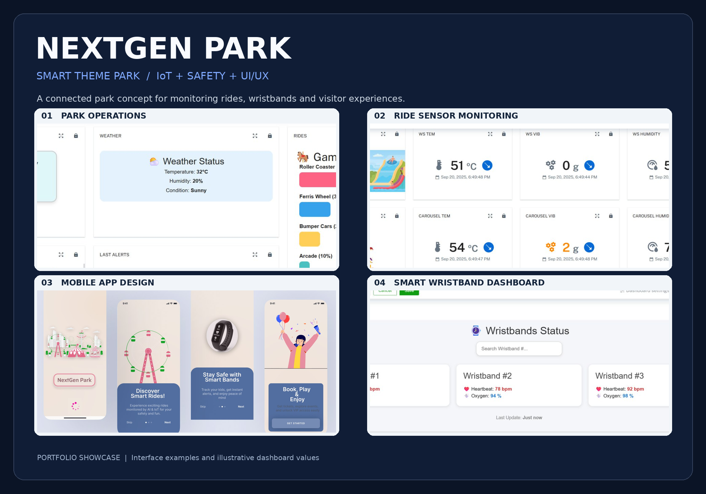

<div align="center">

# 🎡 NextGen Park
### Smart Theme Park · IoT Monitoring · Safety · Mobile UI/UX

**Smarter operations. Safer experiences. Connected visitors.**



[View full-size portfolio cover](NextGen_Park_Portfolio_Cover.png)

</div>

> This is a curated cover showing selected project interfaces. Original detailed screenshots are not published here by default because they require privacy review.

## Overview

NextGen Park is a smart amusement park **project concept with Cumulocity IoT dashboard examples and mobile app designs**. It explores how connected ride sensors, visitor wristbands, dashboard monitoring, and alerts can help park teams respond to operational and safety events.

| Area | Evidence shown in project materials |
|---|---|
| **IoT platform** | Cumulocity IoT device groups, dashboards, alarms and smart-rule interface |
| **Ride monitoring** | Temperature, vibration and humidity widgets for multiple attractions |
| **Visitor operations** | Visitors, capacity, queues, attractions and service dashboard examples |
| **Wristband monitoring** | Location events, geofence alarms, heart rate and oxygen displays |
| **Mobile UX** | Onboarding, discovery, service pages, tickets and checkout mockups |

## The problem

Amusement parks need ways to monitor ride conditions, help families navigate crowded venues, and respond to safety incidents. Disconnected operational information can make rapid decisions harder.

The project is motivated by the importance of ride safety and proactive monitoring. Incident and industry statistics should be verified from original sources before external publication.

## Proposed solution

An integrated park experience where:

1. Ride-related sensor readings are organized on an IoT monitoring platform.
2. Dashboards help operators see attraction status and capacity.
3. Alert interfaces highlight unusual readings, missing device data, or geofence events.
4. Smart wristbands are represented in dashboards for location and basic health monitoring.
5. A companion mobile app design covers park exploration, services, booking, and digital tickets.

## System architecture (conceptual)

```text
Ride sensors (temperature / vibration / humidity) ─┐
                                                   ├─> Cumulocity IoT
Wristband data (location / pulse / oxygen) ─────────┘      │
                                                          ├─> Dashboards
                                                          ├─> Alerts & rules
                                                          └─> Operational review

Visitor app concept ──> discovery / booking / services / tickets
```

This is a **conceptual integration map**, not proof of a deployed production backend.

## Project walkthrough

### 01 · Park operations dashboard
Screens include visitor totals, weather summary, popular rides, waiting times, capacity, alerts, and example tickets.

### 02 · Attraction monitoring
Ride dashboards display sensor readings for roller coaster, Ferris wheel, water slide, and carousel, together with status, maintenance, and example capacity widgets.

### 03 · Wristband and safety dashboard
Screens show location updates, a sample geofence alert, missing-data alarms, and wristband metrics. Location and individual biometric information should be anonymized before any screenshot is made public.

### 04 · Mobile UI/UX
Screens demonstrate splash and onboarding, authentication, event and ride discovery, services, payment selection, tickets, and booking confirmation.

## Tools and topics

**Cumulocity IoT · IoT dashboards · Smart rules and alarms · Sensor monitoring · System architecture · Mobile UI/UX design**

## Scope and evidence

- **Documented visually:** IoT monitoring dashboards, configured device groups, sample alerts, and mobile application screens.
- **Conceptual / not independently validated:** predictive maintenance using AI, deployed GPS tracking, real payment processing, live emergency workflows, and production-scale integrations.
- **Data disclaimer:** numbers visible in project screenshots should not be interpreted as verified operational measurements. Some example interfaces contain third-party trademarks or demonstration content.

## Privacy and sharing

This public write-up deliberately omits personal ticket-holder names, direct wristband/device identifiers, detailed location traces, and person-linked health readings. Share only reviewed, redacted screenshots. Never upload passwords, API tokens, device credentials, private customer data, or production configurations.

## Portfolio assets

The portfolio cover is uploaded and displayed at the top of this page. Detailed original screenshots and presentation files remain separate until they have been reviewed for privacy.

---

[← All portfolio projects](../README.md)
